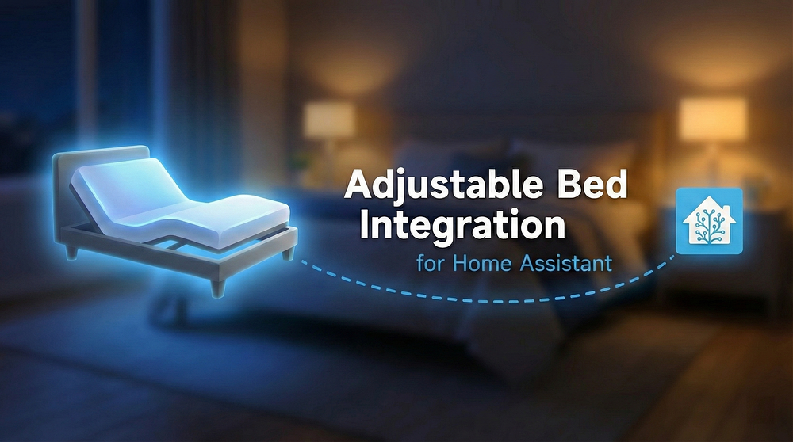

<p align="center">
  
</p>

<p align="center">
  <a href="https://github.com/kristofferR/ha-adjustable-bed/releases"></a>
  <a href="https://github.com/kristofferR/ha-adjustable-bed/actions/workflows/validate.yml"></a>
  
  <a href="https://github.com/sponsors/kristofferR"></a>
</p>

<p align="center">
  A Home Assistant custom integration for controlling smart adjustable beds via Bluetooth.
</p>

## Quick Start

1. **Install** from the Marketplace: under **Settings → Marketplace**, search for "Adjustable Bed" and install it
2. **Discover** your bed automatically, or add manually via Settings → Integrations
3. **Control** your bed from Home Assistant dashboards, automations, and voice assistants!

## Features

- **Set up by app** - Pick the app or remote you use; setup asks only the questions that app needs
- **Native dashboard card** - Auto-loading Lovelace card that adapts to your bed ([details](docs/DASHBOARD_CARD.md))
- **Paired beds** - Left, Right and Both controls for compatible split beds, with reversible conversion of existing entries
- **Motor control** - Raise and lower the head, back, legs and feet
- **Renewable holds** - On beds whose app holds a key until release, a held control keeps the motor running while you hold and stops on its own if the browser goes away ([details](docs/SERVICES.md#renewable-holds))
- **Concurrent motors** - A standalone bed whose app moves several motors at once does so here too ([details](docs/COMMAND_LIFECYCLE.md#merged-stream-for-concurrent-motors))
- **Position control** - Position sliders in degrees or percentages, according to the controller
- **Estimated positions** - Calibrated travel-time estimates and saved positions for beds without position feedback ([details](docs/ESTIMATED_POSITIONS.md))
- **Memory presets** - Jump to saved positions with one tap
- **Guided changes** - Switch an existing bed to another app or layout through **Reconfigure** ([details](docs/CONFIGURATION.md#changing-the-app-or-layout-of-an-existing-bed))
- **Under-bed lights** - RGB color control on supported beds, on and off on others
- **Climate controls** - Cooling, heating and foot warming on supported beds
- **Massage control** - Adjust massage intensity and patterns
- **Position feedback** - See current angles on supported beds
- **Presence sensors** - Occupancy sensors on supported beds
- **Firmness controls** - Sleep Number settings on supported beds
- **Automations** - "Flat when leaving", "TV mode at 8pm" and more

## Need Help?

| Guide | What's Inside |
|-------|---------------|
| **[Troubleshooting](docs/TROUBLESHOOTING.md)** | Connection issues, commands not working |
| **[Getting Help](docs/GETTING_HELP.md)** | Bug reports, support requests, diagnostics |
| **[Connection Guide](docs/CONNECTION_GUIDE.md)** | ESPHome proxy setup, finding your bed's address |
| **[Configuration](docs/CONFIGURATION.md)** | Settings, choosing your remote, combining and splitting beds |
| **[Dashboard Card](docs/DASHBOARD_CARD.md)** | Adding the card, compact room cards, editor and YAML options |
| **[Actions and Automations](docs/SERVICES.md)** | Movement, memory, side targeting, and bed-specific actions |
| **[Wake-up automation](docs/WAKE_UP.md)** | Import a scheduled bed raise or memory recall with optional lighting |
| **[Apple Home and Siri](docs/HOMEKIT.md)** | Raise, lower, and stop commands through HomeKit scenes or Siri Shortcuts |
| **[Supported Actuators](docs/SUPPORTED_ACTUATORS.md)** | Protocol details, bed brand lookup |

See the [documentation index](docs/README.md) for migration and developer guides.

| | |
|---|---|
| 🐛 **[Report a Bug](https://github.com/kristofferR/ha-adjustable-bed/issues/new?template=bug-report.yml)** | Broken controls, connection failures, or regressions |
| 💡 **[Request a Feature](https://github.com/kristofferR/ha-adjustable-bed/issues/new?template=feature-request.yml)** | Missing capabilities and improvements |
| 🛏️ **[Request Bed Support](https://github.com/kristofferR/ha-adjustable-bed/issues/new?template=new-bed-support.yml)** | Unsupported bed brands or models |
| 💬 **[Ask a Question](https://github.com/kristofferR/ha-adjustable-bed/discussions/new?category=help-questions)** | How to configure or use the integration |
| ❤️ **[Praise and Feedback](https://github.com/kristofferR/ha-adjustable-bed/discussions/131)** | Share your experience or say thanks |

Issues track work; Discussions host help and community conversations. You do not
need to prove a problem is a bug before reporting it. See [how reports are
handled](docs/GETTING_HELP.md#how-reports-are-handled).

<details>
<summary><b>Quick troubleshooting</b></summary>

1. **Check range** - Bluetooth adapter or proxy within ~10m of bed
2. **Disconnect other apps** - Most beds allow only one BLE connection
3. **Reload integration** - Settings → Devices & Services → Adjustable Bed → Reload
4. **Enable debug logs** - Settings → Devices & Services → Adjustable Bed → ⋮ menu → Enable debug logging. Reproduce issue, then disable to download logs.

</details>

## ❤️ Support the project

Enjoying Adjustable Bed? Sponsoring its development is a lovely way to say thanks and help keep the project growing.

[](https://github.com/sponsors/kristofferR)

<p align="center">
  
</p>

## Supported Beds

Each row is a family, named as setup names it under **Set up by app or remote**.
Find the app you use, the remote or receiver on your bed, or the brand on the
base. The marks show what has been tested on real hardware:

- ✅ tested on real hardware
- 🧪 implemented from app evidence, not yet tested on hardware
- ⚠️ partly tested: real beds confirmed some controls or models, not all

Each linked guide has a Status line with the details.

| Family | Apps, remotes and receivers | Brands sold with it |
|--------|-----------------------------|---------------------|
| [BedJet PowerLayer](docs/beds/bedjet-powerlayer.md) | [BedJet PowerLayer adjustable frame](docs/beds/bedjet-powerlayer.md) ✅ | BedJet (the frame, not the BedJet climate unit) |
| [BedTech](docs/beds/richmat.md#bedtech) | [BedTech](docs/beds/richmat.md#bedtech) ✅ | BedTech |
| [Casper Base](docs/beds/casper-base.md) | [Casper Base app](docs/beds/casper-base.md) 🧪, [Casper Base sleep sensor, MM or SXB](docs/beds/casper-base.md#separate-sleep-sensors-and-remote-finder) 🧪, [Casper Base remote finder (RCRM handset)](docs/beds/casper-base.md#remote-finder) 🧪 | Casper |
| [Customatic](docs/beds/okin-nframe.md#customatic-family) | [Clarity](docs/beds/okin-nframe.md#customatic-clarity) 🧪, [Jerome's C](docs/beds/okin-nframe.md#customatic-jeromes) 🧪, [Remedy](docs/beds/okin-nframe.md#customatic-remedy) 🧪, [Z-Series Z-230 / Z-280](docs/beds/okin-nframe.md#customatic-z-series) 🧪 | Customatic, Rize (Clarity, Remedy), Jerome's |
| [DewertOkin ELEVATE](docs/beds/okin-5a.md#dewertokin-elevate) | [DewertOkin ELEVATE two-actuator lift](docs/beds/okin-5a.md#dewertokin-elevate) 🧪, [Adjustable Comfort M1X12 ELEVATE](docs/beds/starcode-m1x12.md) 🧪 | DewertOkin |
| [eShine](docs/beds/okin-nframe.md#eshine) | [eShine app: E2000, E3000 / E3100 and E5000](docs/beds/okin-nframe.md#eshine) 🧪 | eShine |
| [Eshine E6000](docs/beds/richmat.md#eshine) | [Eshine app: E6000](docs/beds/richmat.md#eshine) 🧪 | Eshine |
| [GM Control](docs/beds/gmmotor.md) | [GM Control app](docs/beds/gmmotor.md) 🧪, [GM Control sleep module, MM or SXB](docs/beds/gmmotor.md#sleep-modules) 🧪 | GM Control |
| [Good Vibe Sleep](docs/beds/richmat.md#good-vibe-sleep) | [Good Vibe Sleep app](docs/beds/richmat.md#good-vibe-sleep) 🧪, [Good Vibe Sleep sleep sensor, RM- or HJ-](docs/beds/richmat.md#sleep-controls-and-reports) 🧪 | Good Vibe Sleep |
| [HJBed](docs/beds/richmat.md#hjbed) | [HJBed app](docs/beds/richmat.md#hjbed) 🧪 | HJBed |
| [Hush Base](docs/beds/hush-base.md) | [Hush Base app](docs/beds/hush-base.md) 🧪, [Hush Base sleep sensor, MM or SXB](docs/beds/hush-base.md#sleep-transport) 🧪, [Hush Base remote finder (RCRM handset)](docs/beds/hush-base.md#remote-finder) 🧪 | Hush (L200 to L500, S175 to S575 and SH split-head models) |
| [Jensen / Svane](docs/beds/jensen.md) | [Jensen Adjustable Sleep app, JMC400 bed](docs/beds/jensen.md) ✅, [Jensen Adjustable Sleep app, LinOn bed](docs/beds/jensen.md) 🧪, [Svane Remote app](docs/beds/svane.md) ⚠️ | Jensen (JMC400, LinON Entry, LinOn), Svane |
| [Jiecang](docs/beds/jiecang.md) | [ERGOBALANCE](docs/beds/jiecang.md#ergobalance-dreamask) 🧪, [Dream Motion](docs/beds/jiecang.md#dream-motion-dreamotion) 🧪, [Dream Motion HD](docs/beds/jiecang.md#dream-motion-hd) 🧪, [Comfort Motion](docs/beds/jiecang.md#comfort-motion-app) 🧪, [Glide and Lierda remotes (legacy Jiecang, Comfort Motion / Lierda)](docs/beds/jiecang.md#legacy-route) 🧪 | Jiecang, Glideaway, Dream Motion, LOGICDATA |
| [Jordan's](docs/beds/okin-nframe.md#jordans-serenity) | [Jordan's Serenity](docs/beds/okin-nframe.md#jordans-serenity) 🧪, [Jordan's Tranquil](docs/beds/okin-nframe.md#jordans-tranquil) 🧪 | Jordan's |
| [Kaidi](docs/beds/kaidi.md) | [Rize Beds app (Mouselet beds)](docs/beds/kaidi.md) ✅, [Floyd Home app](docs/beds/kaidi.md#floyd-home) 🧪, [ISleep app](docs/beds/kaidi.md#isleep) 🧪 | Rize (Remedy III and newer Mouselet-based beds), Floyd |
| [Keeson](docs/beds/keeson.md) | [Keeson remotes (Base)](docs/beds/keeson.md#base-basei4i5) ✅, [Member's Mark](docs/beds/keeson.md#base-basei4i5) ✅, [Purple](docs/beds/keeson.md#purple-variant) 🧪, [Sleep Harmony](docs/beds/keeson.md#sleep-harmony-variant) 🧪, [Linx / Juna Sleep](docs/beds/keeson.md#jsona00a-variant-juna-linx-ergo-health) 🧪, [KSBT remotes and KSBT03C (Ergomotion Sync)](docs/beds/keeson.md#ksbt-family) ✅, [KSBT03CR and KSBT04C](docs/beds/keeson.md#ksbt-family) 🧪, [Sino and BetterLiving](docs/beds/keeson.md#sino-and-betterliving) ✅, [Ergomotion](docs/beds/keeson.md#ergomotion) ✅, [Ergomotion app](docs/beds/keeson.md#ergomotion-app) 🧪, [Ergomotion 4.0 app](docs/beds/keeson.md#ergomotion-40) 🧪, [Serta Motion Perfect](docs/beds/keeson.md#serta) 🧪, [Serta MP Remote](docs/beds/keeson.md#serta-mp-remote) 🧪, [Tempur Curve](docs/beds/keeson.md#tempur-curve) 🧪, [TEMPUR AU](docs/beds/keeson.md#tempur-au) 🧪, [ROW Control](docs/beds/keeson.md#row-control) 🧪, [Ergo Slim](docs/beds/keeson.md#ergo-slim) 🧪, [Omazz Adjusto III](docs/beds/keeson.md#omazz-adjusto-iii) 🧪, [Q-Plus Adjustable Remote](docs/beds/keeson.md#q-plus-adjustable-remote) 🧪, [SBI/Q-Plus (Costco)](docs/beds/keeson.md#sbi--q-plus-costco) 🧪, [1500 Tilt Base (Rondure)](docs/beds/keeson.md#rondure) 🧪, [Cool Base](docs/beds/keeson.md#cool-base) ✅, [Scott Living](docs/beds/keeson.md#scott-living) 🧪, [Okin FFE (13/15 series)](docs/beds/keeson.md#okin-ffe) 🧪, [Adjustable Lite](docs/beds/keeson.md#adjustable-lite-profile) ⚠️, [Simon Li, Heal Every Night and OKIN-Seating](docs/beds/keeson.md#simon-li-heal-every-night-and-okin-seating-profiles) 🧪, [INNOVA](docs/beds/keeson.md#innova-profile) 🧪, [Restonic BT, remote A or B](docs/beds/keeson.md#restonic-bt-profiles) 🧪, [MaxCoil Una, Dynasty Bases, Bedsense Bases, Avanti Bases and AMERICANSTAR](docs/beds/keeson.md#ore-comfort-bed-profiles) 🧪, [Glideaway Motion / Montion](docs/beds/keeson.md#glideaway-motion) 🧪, [AdjustaMattress](docs/beds/keeson.md#adjustamattress) 🧪, [Comfort Enhancements](docs/beds/keeson.md#comfort-enhancements) 🧪, [BF](docs/beds/keeson.md#bf-and-cherish) 🧪, [Cherish](docs/beds/keeson.md#bf-and-cherish) 🧪 | Ergomotion, Tempur, Beautyrest, King Koil, Member's Mark, Purple, GhostBed, ErgoSportive, Serta, Costco, Restonic, Glideaway, OKIN FFE 13/15 series |
| [Leggett & Platt](docs/beds/leggett-platt.md) | [LP Control and LP Comfort Connect (Leggett & Platt Gen2)](docs/beds/leggett-platt.md#gen2-variant) ⚠️, [Prodigy CE (Okin receiver)](docs/beds/okin-nframe.md#prodigy-ce-prodigy-4) ✅, [Prodigy 2](docs/beds/okin-nframe.md#prodigy-2) 🧪, [Prodigy 2L](docs/beds/okin-nframe.md#prodigy-2l) 🧪, [U Series](docs/beds/okin-nframe.md#u-series) 🧪, [L&P Adjustable Base](docs/beds/richmat.md#lp-legacy-app) 🧪, [L&P app on a QRRM remote (Richmat)](docs/beds/leggett-platt.md#qrrm-richmat-variant) ✅, [MlRM (Leggett & Platt WiLinke)](docs/beds/richmat.md#lp-mlrm) ✅ | Leggett & Platt, Prodigy LBR, Prodigy Comfort Elite, Prodigy 4, Ultra Series |
| [Limoss / Stawett](docs/beds/limoss.md) | [Limoss Remote](docs/beds/limoss.md#limoss-remote) 🧪, [FSM Relax](docs/beds/limoss.md#fsm-relax) 🧪, [Stawett and older Limoss controls](docs/beds/limoss.md#legacy-route) 🧪 | Limoss, Stawett |
| [Linak](docs/beds/linak.md) | [Bed Control, Bed Connect and Performance Series apps](docs/beds/linak.md) ✅ | Tempur-Pedic, Bedre Nætter, Jensen |
| [LOGICDATA](docs/beds/logicdata.md) | [SILVERmotion (Logicdata SimplicityFrame)](docs/beds/logicdata.md) 🧪, [MOTIONrelax phone and tablet](docs/beds/jiecang.md#motionrelax-phone-and-tablet) 🧪, [Sleep Smart Air Mattress](docs/beds/jiecang.md#sleep-smart-air-mattress-bed) 🧪, [Sleep Smart air mattress pump](docs/beds/logicdata-sleep-smart.md) 🧪 | LOGICDATA, SILVERmotion, SimplicityFrame, Sleep Smart Vienna / Toronto / Middle Rail |
| [Malouf / Lucid](docs/beds/malouf.md) | [Malouf Base](docs/beds/malouf.md#malouf-base) 🧪, [Lucid Base](docs/beds/malouf.md#lucid-base) 🧪, [Nordic UART receiver](docs/beds/malouf.md#new_okin) ✅, [FFE5 receiver](docs/beds/malouf.md#legacy-ffe5-route) ✅ | Malouf, Lucid, Structures |
| [MotoMotion](docs/beds/motomotion.md) | [MotoMotion app](docs/beds/motomotion.md) 🧪 | MotoMotion |
| [MotoSleep / Power Bob](docs/beds/motomotion.md#motosleep-and-power-bob-family) | [MotoSleep / Power Bob app, HHC models](docs/beds/motomotion.md#hhc-profiles-names-longer-than-14-characters) ✅, [Power Bob and binary MOTO models](docs/beds/motomotion.md#power-bob-profiles-14-character-names) 🧪 | HHC, Power Bob |
| [OCTO Smart Control](docs/beds/octo.md) | [OCTO Smart Control receivers](docs/beds/octo.md#standard-variant-most-common) ✅, [RTV TV lift](docs/beds/octo.md#one-motor-tv-lift) ⚠️, [Octo Remote Star2](docs/beds/octo.md#star2-variant-octo-remote-star2) ✅ | OCTO |
| [Okin](docs/beds/okin-nframe.md) | [FurniMove / OKIN Smart Remote app](docs/beds/furnimove.md) ⚠️, [Okimat and Lucid remotes (Okin UUID)](docs/beds/okin-nframe.md#okimat) ✅, [DOT remotes (Okin DOT)](docs/beds/okin-nframe.md#okin-dot) 🧪, [RF ECO BT stair lift (OKIN Smart Remote / RF ECO BT single actuator)](docs/beds/okin-nframe.md#rf-eco-bt-stair-lift) ✅, [Okin Handle (DewertOkin)](docs/beds/okin-nframe.md#dewertokin) 🧪, [Okin CB24 (OKIN SmartBed, Amada)](docs/beds/okin-nframe.md#okin-smartbed-cb24) ✅, [Okin 64-Bit](docs/beds/okin-nframe.md#okin-64-bit) 🧪, [Okin 7-Byte (Nectar)](docs/beds/okin-5a.md#nectar) 🧪, [Okin Nordic (Mattress Firm 900, iFlex)](docs/beds/okin-5a.md#mattress-firm-900--iflex) 🧪, [Okin CB35 (Sealy Posturematic)](docs/beds/okin-5a.md#sealy-posturematic-cb35) ✅, [Okin ORE (legacy A5 5A)](docs/CONFIGURATION.md#initial-setup) 🧪, [SIMMONS app](docs/beds/okin-nframe.md#simmons) 🧪, [OKIN SleepEase (DoubleSleep / XiaoBao)](docs/beds/okin-nframe.md#okin-sleepease) 🧪, [Adjustable bed app](docs/beds/okin-nframe.md#adjustable-bed-app) 🧪, [Adjustable bed (Lumbar) app](docs/beds/okin-nframe.md#adjustable-bed-lumbar) ⚠️ | Okimat, Lucid, CVB, Smartbed, Amada, DewertOkin, A H Beard, Hankook Gallery, Rize, Simmons, Nectar, Resident, Symphony, Mattress Firm 900, iFlex, NORA_CON / NORACON, Sealy Posturematic, Elda BTH / MEGAMAT ([all DewertOkin brands](docs/beds/okin-nframe.md#dewertokin-brands)) |
| [Okin CST](docs/beds/okin-nframe.md#okin-cst) | [MFirm 900 - O app](docs/beds/okin-nframe.md#okin-cst) ✅, [Jordan's Sanctuary - O, Resident Adjustable Bed, Rize Aviada - O, POWER BOB ULTRA-O, Rize Contemporary III - O, Carefree, Rize Clarity II - O and Support 挺你 科技調整床 apps](docs/beds/okin-nframe.md#okin-cst) 🧪, [Nectar Move](docs/beds/okin-nframe.md#okin-cst) 🧪, [Okin CST controls without an app profile](docs/beds/okin-nframe.md#okin-cst) ⚠️ | Rize (Sanctuary, Aviada, Bob, Contempo, II Carefree, II Clarity), Resident, Mattress Firm 900-O, Power Bob, Nectar |
| [Remacro](docs/beds/remacro.md) | [Slumberland, The Brick and Jerome's apps](docs/beds/remacro.md) 🧪 | Slumberland, The Brick, Jerome's |
| [Reverie](docs/beds/reverie.md) | [Reverie Nightstand app (Protocol 110)](docs/beds/reverie.md#protocol-110-and-stk) 🧪, [Reverie app (Protocol 108)](docs/beds/reverie.md#protocol-108) 🧪, [Reverie Pairlink (R510L / Harmoniq)](docs/beds/reverie-pairlink-sdk.md) 🧪 | Reverie, Harmoniq |
| [Richmat](docs/beds/richmat.md) | [Richmat remotes, SleepFunction and SVEN & SON apps](docs/beds/richmat.md#richmat-remotes) ✅, [Richmat / RMControl app](docs/beds/richmat.md#rmcontrol) 🧪, [Revive Control, Best Mattress, Blvd Home, HARMONY and Idealbed](docs/beds/richmat.md#richmat-mh-apps) 🧪, [RUF Betten (Motor 2), W.Silver Products, AMERICANSTAR, Bailey's Bed Control and TX apps, and the W.Silver / AMERICANSTAR / Bailey / TX separate sleep receiver](docs/beds/ruf-richmat-apps.md) 🧪, [Avocado Eco Base, CoasterSleep, Forty Winks, Milemont and Superior](docs/beds/richmat.md#classic-richmat-apps) 🧪 | Casper, MLILY, Sven & Son, Avocado, Luuna, Jerome's |
| [Sleep Number](docs/beds/sleep_number.md) | [SleepIQ app, Sleep Number Fuzion (Climate 360, FlexFit, FlexFit Smart)](docs/beds/sleep_number.md#fuzion--climate-360--flexfit) ✅, [Sleep Number BAM/MCR (i8, 360 FlexFit 2)](docs/beds/sleep_number.md#bam--mcr-older-i8--360-flexfit-2) ✅ | Sleep Number |
| [SleepSpa S9000AI](docs/beds/sleepstar.md) | [SleepSpa S9000AI (SLEEPSTAR)](docs/beds/sleepstar.md) 🧪 | SleepSpa |
| [Sleepy's Elite](docs/beds/sleepys.md) | [MFRM Sleepy's Elite app](docs/beds/sleepys.md#explicit-sleepys-elite-app-profile) 🧪, [Sleepy's Elite BOX25 (STAR) receiver](docs/beds/sleepys.md#box25-protocol-nordic-uart) ✅, [Sleepy's Elite BOX15 and BOX24 receivers](docs/beds/sleepys.md#protocol-variants) 🧪 | Sleepy's, Mattress Firm |
| [Solace](docs/beds/ff_frame.md) | [Solace remotes and the HomeKobo, Sealy MotionFlex and Sweet Night apps](docs/beds/ff_frame.md#solace-name-routes) ⚠️, [Woosa Sleep app](docs/beds/ff_frame.md#woosa-sleep) ✅, [BedSense app](docs/beds/ff_frame.md#bedsense) 🧪, [Motion Bed app](docs/beds/ff_frame.md#motion-bed) 🧪 | Solace, Sealy, QMS, SealyMF, TL, Woosa |
| [StarCode](docs/beds/okin-nframe.md#adjustablem5x4) | [AdjustableM5X4](docs/beds/okin-nframe.md#adjustablem5x4) 🧪, [AdjustableM5X5](docs/beds/starcode-m5x5.md) 🧪, [Adjustable Comfort M1X12](docs/beds/starcode-m1x12.md) 🧪 | StarCode |
| [SUTA Smart Home](docs/beds/suta.md) | [SUTA Smart Home](docs/beds/suta.md) ✅ | SUTA |
| [Tempur Sleeptracker-AI](docs/beds/sleeptracker.md) | [Tempur Sleeptracker-AI processor](docs/beds/sleeptracker.md) ⚠️ | Tempur ProSmart / ProSmart Air, ActiveBreeze |
| [TiMOTION AHF](docs/beds/timotion-ahf.md) | [TiMOTION AHF](docs/beds/timotion-ahf.md) 🧪 | TiMOTION |
| [Vibradorm](docs/beds/vibradorm.md) | [Vibradorm remotes](docs/beds/vibradorm.md) ✅, [VMAT](docs/beds/vibradorm.md#vmat) 🧪, [Caresse Diamant and Werkmeister](docs/beds/vibradorm.md#caresse-and-werkmeister) 🧪, [V-MAT Basic (CBI / XT-Box)](docs/beds/vibradorm.md#v-mat-basic) 🧪 | Vibradorm, Caresse, Werkmeister |

When setup asks for an app, model or remote, choose the one supplied with your
bed. A family groups apps that setup asks about together; their commands are
not interchangeable.

**Have one of these?** [Let us know](https://github.com/kristofferR/ha-adjustable-bed/issues) how well it works!

Some brands use more than one family. Let setup detect the bed, or look up the
brand in the [brand and protocol guide](docs/SUPPORTED_ACTUATORS.md).

## Will This Work With My Bed?

**Just try it!** The integration auto-detects most beds. Install it and see if your bed shows up.

**Didn't auto-detect?** Check the [Supported Actuators guide](docs/SUPPORTED_ACTUATORS.md) to find your bed's actuator brand, then add it manually.

**Still stuck?** [Request bed support](https://github.com/kristofferR/ha-adjustable-bed/issues/new?template=new-bed-support.yml) with your bed brand/model and we'll help!

**Other beds:** [Eight Sleep](https://github.com/lukas-clarke/eight_sleep) has its own integration.

**WiFi and cloud-based beds [won't be supported](https://github.com/kristofferR/ha-adjustable-bed/issues/167).** This is a Bluetooth-only integration, for the reasons stated in the link.

## Installation

Requires **Home Assistant 2026.11.0 or newer**.

### Marketplace (Recommended)

1. Open **Settings → Marketplace** in Home Assistant
2. Search for "Adjustable Bed" and open it
3. Select **Install**, check the version and select **Install** again
4. Restart Home Assistant

Upgrading from 4.x to v5? Read the [v5 breaking changes](docs/V5_BREAKING_CHANGES.md)
first. v5 migrates your config entries, and **a Home Assistant backup taken
before the upgrade is the only way back to 4.x**.

### Manual

Use a release archive, or check out `main` for the current development
code. Copy `custom_components/adjustable_bed` to your
`config/custom_components/` directory and restart. The committed frontend bundle
is included; an end-user installation does not require Bun or a frontend build.

## Configuration

Your bed should auto-discover via Bluetooth. If not:

1. Go to **Settings** → **Devices & Services** → **Add Integration**
2. Search for "Adjustable Bed"
3. Choose **Set up by app or remote**, or **Pick any Bluetooth device**

Setup asks which app or remote controls the bed, then that app's own questions,
such as a layout or handset ID. The final settings come last. See
[Initial Setup](docs/CONFIGURATION.md#initial-setup) for the whole journey.

To adjust settings after setup, click **Configure** (the gear icon) for the
integration entry in Settings → Devices & Services, then **Change settings**.
Families with a guided change, such as Okin, Keeson or Leggett & Platt, change
their app or layout through **Reconfigure** in the entry's three-dot menu
instead; see [Changing the app or layout](docs/CONFIGURATION.md#changing-the-app-or-layout-of-an-existing-bed)
for the list.

<details>
<summary><b>Quick reference</b></summary>

| Setting | Description |
|---------|-------------|
| App or remote | Asked first. It decides the commands, layout and features. Change it later with **Reconfigure** where the family has a guided change |
| App questions | The layout, product, handset ID or remote style the app shows |
| Name, Bluetooth adapter | The entry's name, and a preferred adapter or proxy. Home Assistant may still reroute |
| Disconnect after each command | Release the connection one second after operations finish, so the remote or app can connect |
| Motor count, massage | Asked only when the app or remote does not set them |
| Bed-specific fields | Fields one bed type needs, such as a PIN |
| Advanced: receiver route | For a bed type with several receiver routes. An app sets its own route |
| Advanced connection and timing | Motor pulse count and delay, and the idle disconnect timeout |
| Disable angle sensing | Turn off position feedback if monitoring conflicts with the remote |
| Estimated positions | Calibrate travel-time estimates on beds without position feedback |

See the [Configuration Guide](docs/CONFIGURATION.md) for all options.

</details>

## Dashboard Card

The integration ships a native Lovelace card, **Adjustable Bed Card**. It loads
automatically and shows only the controls your bed has: positions, presets,
memory, lighting, massage, climate and connection. Paired beds get Left, Both
sides and Right, and compact room cards give a glance or quick actions.

To add it, edit a dashboard, select **Add Card** and search for
**Adjustable Bed**. Or in YAML:

```yaml
type: custom:adjustable-bed-card
device_id: <your bed device>
```

The [Dashboard Card guide](docs/DASHBOARD_CARD.md) covers holds and tap to
move, paired beds, compact cards, the editor and every YAML option.

## Bluetooth Setup

Works with Home Assistant's native Bluetooth:
- **Local adapter** on your HA host
- **[ESPHome Bluetooth Proxy](https://esphome.io/components/bluetooth_proxy.html)** for extended range

See the [Connection Guide](docs/CONNECTION_GUIDE.md) for setup help.

## Contributing

**We'd love your help!** This integration is actively developed and we're especially looking for:

- **Testers** - Own a bed we haven't fully tested? Your feedback is invaluable
- **Bug reports** - Found something wrong? [Open an issue](https://github.com/kristofferR/ha-adjustable-bed/issues)
- **Code contributions** - PRs welcome!

See the [developer documentation](docs/README.md#development-and-validation)
for environment setup, validation, architecture, and the APK Protocol Audit workflow.

## Credits

Massive thanks to the [smartbed-mqtt](https://github.com/richardhopton/smartbed-mqtt) developers for their pioneering work reverse-engineering bed protocols!

<details>
<summary><b>Migrating from smartbed-mqtt?</b></summary>

This integration replaces smartbed-mqtt with several advantages:
- Uses Home Assistant's native Bluetooth (no ESPHome API issues)
- Works seamlessly with ESPHome Bluetooth proxies
- No MQTT broker required
- Native HA entities

To migrate: Install this integration, configure your bed, verify it works, then remove smartbed-mqtt.

</details>

## License

MIT License - see [LICENSE](LICENSE) for details.
